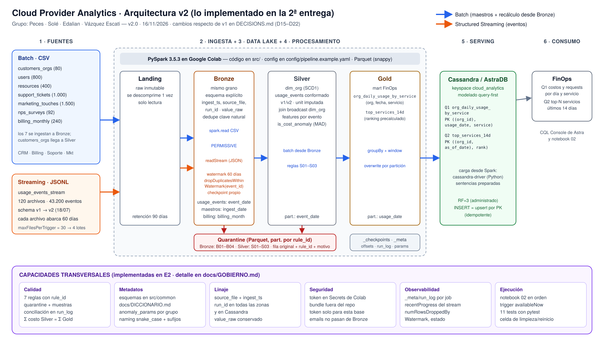

# Cloud Provider Analytics

Pipeline de datos **ETL + Streaming + Serving** para un proveedor de nube: ingesta, limpieza, conformado y publicación de datos de clientes para **FinOps**, **Soporte** y **Producto**.

**Big Data · ITBA · 2C 2026** — Prof. Diego Mosquera
**Grupo:** Cayetana Peces · Abril Solé · Agustina Edalian · Delfina Vázquez Escati

| Entrega | Fecha | Estado |
|---|---|---|
| 1ª · Diseño y fundación de datos | 05/10/2026 (reprogramada) | ✅ entregada: [`docs/DISENO.md`](docs/DISENO.md) |
| 2ª · Implementación técnica | 16/11/2026 | ✅ entregada: [`docs/ENTREGA2.md`](docs/ENTREGA2.md) |
| Final · MVP + defensa | 07/12/2026 | ⏳ [`docs/BACKLOG.md`](docs/BACKLOG.md) |

---

## Arquitectura (v2: lo implementado)

Landing → Bronze (batch para los CSV, Structured Streaming para los eventos) → Silver → Gold (Parquet) → **Cassandra/AstraDB** → FinOps. Patrón **Lambda** (D01): en esta entrega el streaming llega hasta Bronze y Silver/Gold se recalculan en batch (D16).



## Estructura del repositorio

```text
.
├── README.md                 ← este archivo (Quickstart)
├── DECISIONS.md              ← decisiones técnicas y trade-offs (D01–D22)
├── config/pipeline.example.yaml   ← configuración externalizada (sin credenciales)
├── src/
│   ├── common/               ← esquemas, lectura de config, run_log
│   └── jobs/                 ← bronze_batch, bronze_stream, quality, silver, gold, serving
├── notebooks/
│   ├── 01_exploracion_y_bronze.ipynb   ← 1ª entrega (perfil de datos + MapReduce)
│   └── 02_pipeline_e2.ipynb            ← 2ª entrega: pipeline end-to-end
├── cql/                      ← 01_schema.cql (tablas) · 02_consultas.cql (Q1, Q2)
├── tests/                    ← pytest con SparkSession local
├── docs/                     ← diseño, entrega 2, gobierno, diccionario, backlog, diagramas
├── evidence/                 ← salidas de ejecución (run_log, quarantine, tamaños, tests, consultas)
├── data/README.md            ← cómo obtener el dataset
└── infra/README.md           ← entorno
```

## Quickstart (Google Colab)

**Requisitos:** cuenta de Google, el dataset `cloud_provider_challenge_dataset_v1.zip` (campus) y, para la sección de Cassandra, una base de AstraDB con el keyspace `cloud_analytics`, su *Secure Connect Bundle* y un token de aplicación.

1. **Abrir el notebook:** en [Colab](https://colab.research.google.com) → *Archivo → Abrir notebook → GitHub* → `delfivazqueze/cloud-provider-analytics` → `notebooks/02_pipeline_e2.ipynb`.
2. **Subir los archivos:** en el panel izquierdo, ícono de **carpeta** → subir a `/content`:
   - `cloud_provider_challenge_dataset_v1.zip`
   - `secure-connect-big-data.zip` (el bundle de AstraDB; si no se sube, el notebook saltea la sección 8).
3. **Cargar el token:** panel izquierdo, ícono de **llave (Secrets)** → *Agregar secreto* → nombre `ASTRA_DB_APPLICATION_TOKEN`, valor el token `AstraCS:...` → activar *Acceso al notebook*.
4. **Ejecutar:** *Entorno de ejecución → Ejecutar todo* (≈5 minutos). La primera celda instala PySpark 3.5.3 y clona el repo para importar `src/`.
5. **Resultado esperado:**
   - Bronze: 7 maestros + `usage_events` (43.200 eventos, 4 micro-lotes, 0 descartados por watermark).
   - Silver: 42.989 eventos + 211 en quarantine (`S01_COSTO_NEGATIVO`); 2.033 `unit` imputadas.
   - Gold: `org_daily_usage_by_service` con 11.050 filas (grano único) y `top_services_14d` con 12.314.
   - Idempotencia: todos los conteos iguales al re-ejecutar; el stream re-lanzado lee 0 filas.
   - AstraDB: 11.050 filas en `org_daily_usage_by_service`, resultados de Q1 y Q2, conteo igual al recargar.
   - Evidencias en `/content/evidence/`.

**Pruebas:** en una celda nueva del mismo Colab:
```bash
!cd /content/cloud-provider-analytics && python -m pytest -q tests
```

**Limpieza / reinicio:** última celda del notebook (borra todo el lake menos Landing, incluidos los checkpoints) o *Entorno de ejecución → Desconectar y borrar el entorno*. Para borrar las tablas de Cassandra: `DROP TABLE cloud_analytics.org_daily_usage_by_service;` y `DROP TABLE cloud_analytics.top_services_14d;` en la CQL Console.

**Versiones:** Python 3.10+ · PySpark 3.5.3 · Java 11/17 (el de Colab) · cassandra-driver 3.29+ · PyYAML.

### Solución de problemas

| Síntoma | Causa | Solución |
|---|---|---|
| `Credenciales de AstraDB disponibles: False` | falta el bundle en `/content` o el secreto no tiene acceso al notebook | revisar los pasos 2 y 3 |
| Timeout o `NoHostAvailable` al conectar | la base de AstraDB se hiberna si no se usa | en el portal de Astra, entrar a la base y tocar **Resume**; esperar a que diga *Active* |
| `git clone` falla en la primera celda | el repo no es público | subir el repo como zip a `/content` y descomprimirlo como `cloud-provider-analytics` |
| `Unable to infer schema for Parquet` | se borró una zona a mano pero no su checkpoint | correr la celda de limpieza completa (borra también `_checkpoints`) |

## Configuración

`config/pipeline.example.yaml` concentra rutas, particiones de shuffle, parámetros del stream (`max_files_per_trigger`, `watermark`, `trigger`), umbrales de calidad y el keyspace. Para cambiar valores se copia a `config/pipeline.yaml` (ignorado por git) y tiene prioridad sobre el ejemplo.

## Convenciones

- **Zonas:** `landing/` (inmutable) · `bronze/` · `silver/` · `gold/` · `quarantine/` · `_checkpoints/` · `_meta/`.
- **Nombres:** `snake_case`; particiones Hive `columna=valor`; sufijos `_usd`, `_kg`, `_ts`, `_date`; flags con prefijo `is_`.
- **Columnas técnicas:** `ingest_ts`, `source_file`, `run_id` en todas las zonas.
- **Reglas de calidad:** `rule_id` con prefijo de zona (`B` Bronze, `S` Silver); catálogo en `docs/GOBIERNO.md`.
- **Secretos:** nunca en el repo. Token en *Secrets* de Colab; el bundle está en `.gitignore`.
- **Commits:** en español con prefijo (`docs:`, `feat:`, `fix:`, `data:`, `test:`).

## Limitaciones actuales

- El streaming llega hasta Bronze; Silver, Gold y Cassandra se recalculan en batch (D16). La vista incremental de la capa speed está en el backlog (M5).
- Está implementado el mart FinOps `org_daily_usage_by_service` y las consultas Q1 y Q2. Q3–Q5 y los marts de revenue, soporte, GenAI y anomalías son de la entrega final.
- El componente analítico es la detección de anomalías por MAD (D20); no hay etiquetas para medir precisión.
