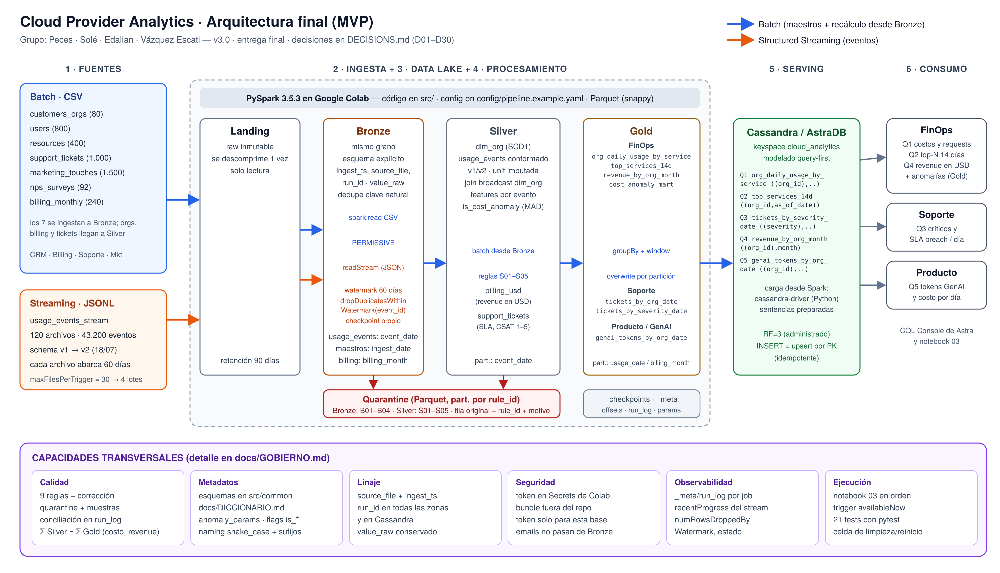

# Cloud Provider Analytics — Documentación técnica final (MVP)

**Big Data · ITBA · 2C 2026 · Prof. Diego Mosquera** · versión 3.0 · entrega final  
**Grupo:** Cayetana Peces · Abril Solé · Agustina Edalian · Delfina Vázquez Escati  
**Repositorio:** https://github.com/delfivazqueze/cloud-provider-analytics

> **Resumen.** Plataforma de datos para FinOps, Soporte y Producto de un proveedor de nube. Los 7 CSV entran por batch y los eventos de uso por Structured Streaming a un Data Lake en Parquet (Landing → Bronze → Silver → Gold); los 5 marts de negocio se publican en Cassandra/AstraDB con un modelo query-first que responde las 5 consultas de la consigna. Todo corre de punta a punta en un notebook (`notebooks/03_mvp_final.ipynb`) que llama a funciones de `src/` con configuración externa; las cifras de este documento salen de esa ejecución (`evidence/final_resumen.json`).

## 1. Checklist de la entrega final (§9.3) → evidencia

| Ítem | Evidencia |
|---|---|
| Pipeline completo batch y streaming | notebook 03 §1–§8 · `src/jobs/` |
| Data Lake y arquitectura final consistentes | §3–§4 · `docs/img/arquitectura_final.png` |
| Marts Gold para los dominios requeridos | §8: 5 marts (FinOps, Soporte, Producto/GenAI) |
| Cinco consultas obligatorias desde AstraDB | §9 · `cql/02_consultas.cql` · `evidence/final_cassandra_q1..q5.csv` · `evidence/capturas/` |
| Analítica o ML integrado | §7: anomalías MAD + `cost_anomaly_mart` |
| Calidad, quarantine, metadatos, linaje, seguridad y observabilidad | §6 y §11 · `docs/GOBIERNO.md` |
| Idempotencia, pruebas, configuración externa y manejo de errores | §10 y §12 · `tests/` · `config/` |
| Repositorio final sin secretos | token en Secrets de Colab; bundle y `config/pipeline.yaml` en `.gitignore` |
| README Quickstart validado desde un entorno limpio | `README.md` |
| Documentación técnica y diccionario de datos | este documento · `docs/DICCIONARIO.md` · `DECISIONS.md` |

## 2. Problema y objetivos medibles

Somos el área de datos de un proveedor de nube: los datos de clientes llegan crudos, desde sistemas distintos y con errores, y hay que publicarlos limpios para tres áreas. Los objetivos se definieron en la E1 (`docs/DISENO.md` §1); este es su resultado:

| # | Objetivo | Resultado |
|---|---|---|
| O1 | Frescura de las métricas de uso | Redefinido en D26: la frescura es la de una corrida completa Landing → Cassandra (minutos). Una vista incremental no aporta porque cada micro-lote toca el 64 % de las claves |
| O2 | Cero pérdida silenciosa | ✅ Bronze 43.200 = Silver 43.196 + quarantine 4; conciliación automática en `_meta/run_log` |
| O3 | Idempotencia | ✅ todos los conteos iguales al re-ejecutar, también en Cassandra (§10) |
| O4 | Compatibilidad de esquema | ✅ v1 10.800 = 10.799 + 1 en quarantine; v2 32.400 = 32.397 + 3 |
| O5 | Revenue comparable | ✅ 240 de 240 facturas con `revenue_usd` |
| O6 | Serving eficiente | ✅ las 5 consultas leen una sola partición (`WHERE` sobre la partition key) |
| O7 | Anomalías útiles | ✅ 191 eventos (0,44 %), por debajo del techo de ~1 % |

## 3. Arquitectura final

**Patrón Lambda con una sola base de código Spark (D01).** Los maestros, la facturación y los tickets son batch por naturaleza; los eventos entran por Structured Streaming. El streaming llega hasta Bronze y la vista exacta (Silver, Gold y Cassandra) se recalcula en batch desde Bronze (D16). La vista incremental de la capa speed no se implementó porque los eventos llegan desordenados: cada archivo trae eventos de los 60 días y cada micro-lote toca el 64 % de las 11.050 claves (org, fecha, servicio), así que actualizar "solo lo nuevo" es recalcular casi todo (D26).

| Capa | Implementación | Equivalente a escala |
|---|---|---|
| Ingesta batch | `spark.read` CSV con esquema explícito, `PERMISSIVE` + `_corrupt_record` | Spark en Dataproc/EMR |
| Ingesta streaming | `readStream` JSON, `maxFilesPerTrigger = 30`, watermark 60 días, `dropDuplicatesWithinWatermark(event_id)`, checkpoint por query, `trigger(availableNow)` | Kafka + `processingTime` |
| Almacenamiento | Parquet snappy particionado en `/content/datalake` | Object storage (S3/GCS) |
| Procesamiento | Spark DataFrames (PySpark 3.5.3, `local[*]`) | Clúster YARN/K8s |
| Serving | AstraDB (Cassandra 4), keyspace `cloud_analytics`, carga con `cassandra-driver` | Spark Cassandra Connector |
| Consumo | CQL Console de Astra / notebook | Herramienta de BI |

**Cambios respecto del diseño v1** (detalle en `DECISIONS.md`): costos negativos (D29), watermark de 60 días medido (D15), streaming hasta Bronze (D16), `availableNow` (D17), driver de Python (D18), lake en `/content` (D14), `escape='"'` en los CSV (D21), tipo de cambio 1 para facturas en USD (D23), CSAT en [1, 5] (D24), Q3 global (D25), O1 redefinido (D26), registro de fallos (D30).

## 4. Data Lake

| Zona | Responsabilidad | Particiones | Promoción |
|---|---|---|---|
| Landing | Archivos originales, solo lectura | — | archivo legible con nombre esperado |
| Bronze | Mismo grano, tipos explícitos, `ingest_ts`, `source_file`, `run_id`, dedupe | eventos: `event_date`; maestros: `ingest_date`; facturación: `billing_month` | clave no nula, fecha parseable, esquema válido (B01–B04) |
| Silver | Conformado, joins, nulos/outliers, v1/v2 | eventos: `event_date`; facturación: `billing_month` | reglas S01–S05 y conciliación |
| Gold | Marts por dominio, grano declarado | `usage_date` / `billing_month` | grano único y Σ Silver = Σ Gold |
| Quarantine | Fila original + `rule_id` + `motivo` | `rule_id` | se reprocesa al corregir la regla o la fuente |

| Zona | Dataset | Particiones | Archivos | KB |
|---|---|---|---|---|
| Bronze | usage_events | 60 | 240 | 4.027 |
| Silver | usage_events | 60 | 60 | 3.237 |
| Gold | org_daily_usage_by_service | 60 | 60 | 647 |
| Gold | cost_anomaly_mart | 60 | 60 | 634 |

Retención, naming y metadatos se mantienen como en el diseño (`docs/DISENO.md` §7). Bronze tiene 4 archivos por fecha (uno por micro-lote); Silver y Gold, uno (`repartition` por fecha antes de escribir). Detalle completo en `evidence/final_lake_stats.csv`.

## 5. Ingesta

**Batch.** Los 7 CSV a Bronze: 4.112 filas, 0 corruptas, 0 claves nulas, 0 duplicadas. La regla B01 detectó en la primera corrida que `tags_json` de `resources` se leía truncado (comillas escapadas al estilo CSV estándar) y se corrigió con `escape='"'` (D21).

**Streaming.** 120 archivos → 4 micro-lotes → 43.200 eventos en Bronze, 0 a quarantine, 0 descartados por tardíos. Dos queries con checkpoint propio (válidos → Bronze; inválidos → quarantine). **Watermark medido (D15):**

| Watermark | Descartados por tardíos | Claves en estado |
|---|---|---|
| 2 días | 20.874 (48 %) | 2.181 |
| 60 días | 0 | 43.200 (~11 MB) |

## 6. Silver y calidad

| Dataset | Filas | Tratamiento principal |
|---|---|---|
| `dim_org` | 80 | SCD1 (D22); NPS fuera de [−100, 100] → null + flag (1) |
| `usage_events` | 43.196 | normalización; v1/v2 con `null` en `carbon_kg`/`genai_tokens` de v1; `unit` imputada (2.038); costos negativos con consumo corregidos de signo (212, D29); join broadcast con `dim_org`; features por evento; score MAD |
| `billing_usd` | 240 | `revenue_usd = (subtotal − credits + taxes) × fx`; credits nulos = 0; 13 ajustes (subtotal negativo); 160 facturas USD con fx llevado a 1 (D23, impacto −0,08 %) |
| `support_tickets` | 1.000 | fechas, `sla_breached` booleano, `is_open`, días de resolución; 40 CSAT fuera de [1, 5] → null (D24) |

**Reglas activas:** B01–B04 en Bronze; S01 costo negativo sin consumo medido (4 a quarantine con `is_cost_anomaly`; los 212 con consumo se corrigen, ver abajo), S02 `unit` no nulo si hay `value`, S03 org inexistente, S04 moneda/tipo de cambio inválido, S05 fecha inválida. Las que dan 0 casos se prueban con datos armados en `tests/`. Catálogo completo en `docs/GOBIERNO.md` §2.

**Semántica de los costos negativos (D29).** `cost_usd_increment` es el cargo por un consumo medido; el negocio registra los créditos y ajustes comerciales en facturación (`credits` y notas de crédito). Los 216 eventos con costo negativo se analizaron antes de decidir (notebook 03 §4.2.1):

| Evidencia | Resultado | Qué indica |
|---|---|---|
| ¿Tienen consumo medido? | 212 con `value > 0`; 4 sin valor | hubo uso real |
| \|costo\| ÷ consumo vs. precio unitario típico de su servicio y métrica | mediana 1,02× (p10 0,82×, p90 1,18×) | es el precio normal con el signo invertido |
| ¿Anulan un cargo anterior del mismo recurso? | 4 coincidencias, en fechas y métricas distintas (igual que por azar) | no son reversas |
| ¿Se concentran en clientes? | 68 de 80 organizaciones, los 6 servicios | no son créditos comerciales |

**Definición:** un costo negativo con consumo es un error de signo de la telemetría. Se corrige al valor absoluto, se conserva el original en `cost_usd_raw` y queda el flag `is_cost_sign_corrected`; sin consumo no se puede validar y va a quarantine (S01). Impacto sobre el costo publicado:

| Alternativa | Costo total | Diferencia |
|---|---|---|
| Quarantine de los menores a −0,01 (2ª entrega) | 148.351,60 USD | −0,60 % |
| **Corregir el signo (adoptada)** | **149.246,81 USD** | — |
| Conservarlos negativos como ajuste | 147.433,98 USD | −1,21 % |

## 7. Componente analítico: anomalías de costo

No hay una variable objetivo etiquetada, así que en lugar de un modelo supervisado de Spark ML se usa un método robusto no supervisado de los que plantea la consigna (D09, D20): `mad_score = 0.6745·|costo − mediana| / MAD` **por (servicio, métrica)**, umbral 3.5.

| Método | Eventos marcados | En networking (servicio barato) |
|---|---|---|
| z-score global > 3 | 70 | 1 |
| **MAD por grupo > 3.5** | **191 (0,44 %)** | 27 |

El resultado se publica en `cost_anomaly_mart` (D28): **190 días (org, servicio) con anomalías que suman 11.312,96 USD, el 7,6 % del costo total** del período, cada uno con su score máximo y la comparación contra la mediana diaria de esa org y servicio. **Limitaciones:** sin etiquetas no se pueden medir precisión ni recall; el umbral 3.5 es el estándar del método y no está calibrado con feedback de negocio.

## 8. Gold

| Dominio | Mart | Grano | Filas | Control |
|---|---|---|---|---|
| FinOps | `org_daily_usage_by_service` | org_id, usage_date, service | 11.050 | Σ costo Silver = Σ Gold = 149.246,81 USD |
| FinOps | `top_services_14d` (vista para Q2) | org_id, as_of_date, rank | 12.314 | ranking por costo de 14 días |
| FinOps | `revenue_by_org_month` | org_id, billing_month | 240 | Σ revenue Silver 164.293,06 = Gold 164.293,07 (redondeo) |
| FinOps | `cost_anomaly_mart` | org_id, usage_date, service | 11.050 | mismo grano que el mart de uso |
| Soporte | `tickets_by_org_date` | org_id, ticket_date, severity | 984 | Σ tickets = 1.000 |
| Soporte | `tickets_by_severity_date` (vista para Q3) | severity, ticket_date | 575 | días sin tickets = 0; `all` = 1.000 |
| Producto | `genai_tokens_by_org_date` | org_id, usage_date | 1.131 | Σ tokens Silver = Gold = 2.558.359 |

Todos los marts tienen grano único (verificado en el notebook). Revenue total en USD: junio 60.492,82 · julio 54.037,59 · agosto 49.762,66.

## 9. Serving en AstraDB y consultas

Modelo **query-first**: una tabla por consulta, cada consulta lee una sola partición (`cql/01_schema.cql`). Carga desde Spark con el driver de Python, sentencias preparadas y escritura concurrente; `INSERT` es upsert por PK, así que recargar no duplica.

| Consulta | Tabla | PRIMARY KEY | Por qué |
|---|---|---|---|
| Q1 costos y requests diarios por org y servicio en un rango | `org_daily_usage_by_service` | `((org_id), usage_date, service)`, `usage_date DESC` | el rango de fechas se resuelve dentro de la partición de la org |
| Q2 top-N servicios por costo de los últimos 14 días | `top_services_14d` | `((org_id, as_of_date), rank)`, `rank ASC` | Cassandra no ordena por agregados: el ranking viene de Spark y `LIMIT N` alcanza |
| Q3 tickets críticos y tasa de SLA breach por día, últimos 30 días | `tickets_by_severity_date` | `((severity), ticket_date)`, `ticket_date DESC` | una partición por severidad con una fila por día, sin huecos (D25) |
| Q4 revenue mensual con créditos e impuestos, en USD | `revenue_by_org_month` | `((org_id), billing_month)`, `billing_month DESC` | la serie mensual de una org en una partición |
| Q5 tokens GenAI y costo estimado por día | `genai_tokens_by_org_date` | `((org_id), usage_date)`, `usage_date DESC` | el rango de fechas se lee de una partición (D27) |

**Resultados** (CQL completo en `cql/02_consultas.cql`; salidas en `evidence/final_cassandra_q*.csv`; capturas en `evidence/capturas/`):

**Q1** — `org_ktakpuxq`, 18/08 a 31/08: 35 filas (día × servicio). Ej.: 31/08 compute 27,99 USD y 344 requests; genai 10,97 USD y 108 requests.

**Q2** — `org_ktakpuxq` al 31/08: 1) compute 659,55 USD · 2) genai 141,82 USD · 3) database 64,39 USD.

**Q3** — críticos del 02/08 al 31/08: 30 días, 17 tickets críticos y 0 con SLA breach (en el mismo período, para todas las severidades: 246 tickets y 30 breaches, 12,2 %).

**Q4** — `org_ktakpuxq`:

| billing_month | moneda | subtotal_usd | credits_usd | taxes_usd | revenue_usd |
|---|---|---|---|---|---|
| 2025-08 | ARS | −2,13 | 0,00 | 0,45 | −1,68 |
| 2025-07 | USD | 654,61 | 0,00 | 137,47 | 792,08 |
| 2025-06 | USD | 283,18 | 0,00 | 59,47 | 342,65 |

**Q5** — `org_pbhsahxt` (la de más tokens), 18/08 a 31/08: 14 días, 57.986 tokens y 548,44 USD. Ej.: 31/08, 2.488 tokens, 24,72 USD (9,94 USD por 1.000 tokens).

## 10. Idempotencia

| Dataset | Antes | Después de re-ejecutar |
|---|---|---|
| bronze.usage_events (stream re-lanzado: lee 0 filas) | 43.200 | 43.200 |
| silver.usage_events / quarantine | 43.196 / 4 | 43.196 / 4 |
| silver.billing_usd / support_tickets | 240 / 1.000 | 240 / 1.000 |
| gold (7 tablas) | 11.050 · 12.314 · 240 · 984 · 575 · 1.131 · 11.050 | iguales |
| Cassandra `org_daily_usage_by_service` (recarga completa) | 11.050 | 11.050 |

Mecanismos: checkpoint por query en el stream, dedupe por clave natural, overwrite dinámico por partición y upsert por PK en Cassandra.

## 11. Gobierno, seguridad y observabilidad

Detalle en `docs/GOBIERNO.md` (matriz de dueños, reglas, linaje, metadatos y acceso) y `docs/DICCIONARIO.md`.

- **Linaje:** `source_file`, `ingest_ts` y `run_id` en todas las zonas (`run_id` también en Cassandra) → `_meta/run_log`.
- **Seguridad:** token de AstraDB con rol limitado a la base, en Secrets de Colab; bundle fuera del repo; `users.email` (dato personal) no pasa de Bronze; facturación clasificada como confidencial.
- **Observabilidad y manejo de errores:** `_meta/run_log` por job con conciliación (`CONCILIACION_FALLIDA` si no cierran los conteos) y estado `ERROR` con el mensaje si un job falla (D30); métricas del stream (`numRowsDroppedByWatermark`, filas en estado); filas y errores por tabla en cada carga a Cassandra.

## 12. Pruebas y reproducibilidad

- **21 tests** con `pytest` + SparkSession local (`evidence/final_tests_pytest.txt`):
  - **calidad:** reglas B y S con casos armados, corrección de signo, filas corruptas y duplicadas, JSON corrupto en el stream;
  - **idempotencia:** pipeline de punta a punta (Landing → Gold) ejecutado dos veces sobre un lake de prueba, con reentrega de eventos: mismos conteos, mismo costo y grano único; re-ejecución del stream con checkpoint (0 filas);
  - **fallos:** un archivo faltante en Landing deja el job registrado como `ERROR` en `_meta/run_log` y detiene la ejecución; conciliación fallida detectada;
  - **serving:** carga a Cassandra por lotes con conteo de errores y conteo por partición, con una sesión simulada; script CQL con las 5 PK;
  - **marts:** v1/v2, MAD por grupo, grano y sumas, conversión a USD con una factura de cada moneda, CSAT, serie de Q3 sin huecos, GenAI.
- **Reproducibilidad:** Quickstart en el README (Colab limpio + dataset + bundle + token), configuración en `config/pipeline.example.yaml`, sin credenciales en el repo, celda de limpieza/reinicio y tabla de solución de problemas.

## 13. Limitaciones y próximos pasos

| Limitación | Próximo paso |
|---|---|
| Sin vista incremental de la capa speed (D26) | si los eventos llegaran ordenados: watermark corto + `foreachBatch` con upsert de las claves del lote |
| Bronze de eventos con 4 archivos por fecha | compactación periódica |
| Anomalías sin etiquetas para medir precisión | recolectar feedback de FinOps sobre las alertas y calibrar el umbral |
| `dim_org` SCD1 | SCD2 desde los snapshots de Bronze |
| Carga a Cassandra desde el driver de Spark (D18) | Spark Cassandra Connector al escalar |
| Costo GenAI estimado con el costo de los eventos (D27) | tarifa por token si la provee el negocio |

## 14. Roles

| Integrante | Responsable de |
|---|---|
| Cayetana Peces | Ingesta: batch, Structured Streaming, watermark y checkpoints |
| Abril Solé | Procesamiento y calidad: Silver, reglas y quarantine, anomalías |
| Agustina Edalian | Gold y serving: marts, modelo Cassandra, carga y consultas |
| Delfina Vázquez Escati | Arquitectura y gobierno: configuración, run_log, idempotencia, gobierno, documentación |
