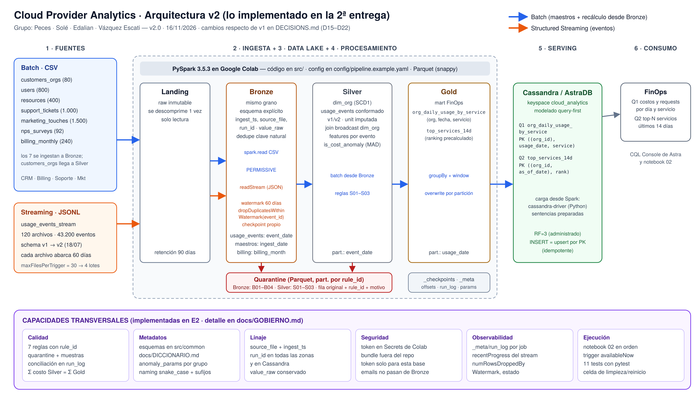

# Cloud Provider Analytics — Segunda entrega: implementación técnica

**Big Data · ITBA · 2C 2026 · Prof. Diego Mosquera** · versión 2.0 · 16/11/2026  
**Grupo:** Cayetana Peces · Abril Solé · Agustina Edalian · Delfina Vázquez Escati  
**Repositorio:** https://github.com/delfivazqueze/cloud-provider-analytics

> **Resumen.** El diseño de la E1 ya corre: Landing → Bronze (batch y Structured Streaming) → Silver → Gold → AstraDB, en un solo notebook (`notebooks/02_pipeline_e2.ipynb`) que llama a funciones de `src/` con la configuración en `config/`. Todas las cifras de este documento salen de esa ejecución (`evidence/02_resumen.json`). Lo que cambió respecto del diseño está registrado en `DECISIONS.md` (D15–D22) y lo que falta para la final en `docs/BACKLOG.md`.

## 1. Checklist de la consigna (§9.2) → dónde está la evidencia

| Ítem | Estado | Evidencia |
|---|---|---|
| Correcciones de la 1ª entrega | ✅ | `docs/plan_correcciones.md` (3 del feedback + 5 que surgieron al implementar) |
| Arquitectura actualizada | ✅ | `docs/img/arquitectura_v2.png`: solo lo implementado |
| Tres maestros batch en Bronze | ✅ (7) | notebook 02 §2 · `evidence/02_run_log.csv` |
| Streaming con esquema, watermark, dedupe, late data y checkpoint | ✅ | notebook 02 §3 · `evidence/02_watermark_experimento.csv` · `tests/test_ingesta.py` |
| Silver para eventos y al menos un maestro | ✅ | `silver/usage_events` + `silver/dim_org` (§4) |
| Tres features | ✅ (6) | `daily_cost_usd`, `requests`, `cpu_hours`, `storage_gb_hours`, `genai_tokens`, `carbon_kg` |
| Tres reglas de calidad y quarantine | ✅ (7) | `docs/GOBIERNO.md` §2 · `evidence/02_quarantine_muestras.csv` |
| Mart `org_daily_usage_by_service` en Gold | ✅ | §6 · `evidence/02_gold_muestra.csv` |
| Keyspace y tabla Cassandra/AstraDB poblada | ✅ | `cql/01_schema.cql` · §8 · `evidence/capturas/` |
| Dos consultas CQL con resultados | ✅ | `cql/02_consultas.cql` · `evidence/02_cassandra_q1.csv`, `02_cassandra_q2.csv` |
| Componente analítico | ✅ | anomalías MAD (§5) · D20 |
| Idempotencia demostrada | ✅ | §7 y §8 (conteos antes/después) |
| README Quickstart, logs y evidencias | ✅ | `README.md` · `evidence/` · `_meta/run_log` |
| Backlog final priorizado | ✅ | `docs/BACKLOG.md` (MoSCoW) |

## 2. Arquitectura v2 y cambios respecto del diseño v1

| Diseño v1 | Implementación v2 | Por qué |
|---|---|---|
| Watermark "2 days" (decisión abierta) | **60 días** | medido: con 2 días se pierde el 48 % de los eventos (D15) |
| Capa speed con `foreachBatch` hasta Cassandra | streaming hasta Bronze; Silver/Gold en batch | alcance mínimo, sin sobre-ingeniería; la vista incremental queda para la final (D16) |
| Trigger de 5 minutos | `availableNow` + 30 archivos por lote | reproducible en Colab; mismo código con `processingTime` (D17) |
| Spark Cassandra Connector | driver de Python | más simple en Colab para ~23 mil filas (D18) |
| Lake en Google Drive | `/content` | el pipeline se reconstruye en minutos (D14) |
| Lectura CSV por defecto | `escape='"'` + `_corrupt_record` | la regla B01 encontró `tags_json` truncado (D21) |

## 3. Ingesta

**Batch (7 CSV → Bronze).** Esquema explícito + modo `PERMISSIVE` con `_corrupt_record`; corruptas (`B01`) y claves nulas (`B02`) a quarantine; dedupe por clave natural; partición por `ingest_date` (snapshot) y `billing_month`. Resultado: 4.112 filas, 0 en quarantine, 0 duplicadas.

**Streaming (`usage_events_stream/*.jsonl` → Bronze).** `readStream` con el mismo esquema de la E1, `maxFilesPerTrigger = 30` (4 micro-lotes) y dos queries con checkpoint propio, como en el laboratorio de la clase: válidos → `withWatermark` + `dropDuplicatesWithinWatermark(event_id)` → Parquet por `event_date`; inválidos (`B02`–`B04`) → quarantine.

**Elección del watermark (late data).** Cada archivo trae eventos de los 60 días, así que el orden de llegada no sigue al tiempo del evento. Corrimos la misma query contra un sink `noop`:

| Watermark | Eventos leídos | Descartados por tardíos | Emitidos | Claves en estado |
|---|---|---|---|---|
| 2 días | 43.200 | **20.874 (48 %)** | 22.326 | 2.181 |
| 60 días | 43.200 | 0 | 43.200 | 43.200 (~11 MB) |

Con 60 días no se pierde nada y el estado es chico. El dedupe con reentrega real (un `event_id` repetido en otro archivo) y el evento tardío se prueban en `tests/test_ingesta.py`.

## 4. Silver y calidad

- **`dim_org`:** último snapshot (SCD1, D22), tipos explícitos, NPS fuera de [−100, 100] → `null` + flag (1 caso: NPS = 101).
- **`usage_events`:** normalización de strings; v1/v2 compatibles (`carbon_kg` y `genai_tokens` quedan `null` en v1, no 0); `unit` imputada desde `metric` (2.033 eventos, D08); costos entre −0.01 y 0 → 0; join **broadcast** con `dim_org` (el plan físico muestra `BroadcastHashJoin`); features por evento.

| Regla | Casos | Tratamiento |
|---|---|---|
| S01 `cost_usd_increment >= -0.01` | 211 | quarantine + `is_cost_anomaly` |
| S02 `unit` no nulo si hay `value` | 2.033 | imputadas (`unit_imputed`); 0 sin imputar |
| S03 `org_id` existe en `dim_org` | 0 | quarantine |

**Conciliación (O2):** Bronze 43.200 = Silver 42.989 + quarantine 211. **Compatibilidad (O4):** v1 10.800 = 10.738 + 62; v2 32.400 = 32.251 + 149.

## 5. Componente analítico: anomalías de costo

No hay etiquetas de qué costo es anómalo, así que en lugar de un modelo supervisado de Spark ML usamos un método robusto no supervisado de los que plantea la consigna: `mad_score = 0.6745·|costo − mediana| / MAD` **por (servicio, métrica)**, con umbral 3.5. Los parámetros de cada grupo quedan en `_meta/anomaly_params`.

| Método | Eventos marcados | En networking (servicio barato) |
|---|---|---|
| z-score global > 3 | 70 | 2 |
| **MAD por grupo > 3.5** | **191 (0,44 %)** | 27 |

La tasa queda por debajo del techo de ~1 % de O7 y se reparte entre los 18 grupos (0,27 %–0,69 %). Las más fuertes son requests con costo ~100× la mediana de su grupo. **Limitación:** sin etiquetas no se pueden medir precisión ni recall. **Cierre:** `cost_anomaly_mart` en la final (M4).

## 6. Gold

`org_daily_usage_by_service`, grano **(org_id, usage_date, service)**, particionado por `usage_date`: 11.050 filas, 0 claves duplicadas, Σ costo Silver = Σ costo Gold = 148.351,60 USD. Coincide con las 11.050 claves del MapReduce de la E1.
`top_services_14d` (12.314 filas) precalcula el ranking de servicios por costo de los últimos 14 días para cada org y fecha con al menos 14 días de historia.

| Zona | Dataset | Particiones | Archivos | KB |
|---|---|---|---|---|
| Bronze | usage_events | 60 | 240 | 4.027 |
| Silver | usage_events | 60 | 60 | 3.237 |
| Gold | org_daily_usage_by_service | 60 | 60 | 647 |

Bronze tiene 4 archivos por fecha (uno por micro-lote); Silver y Gold, uno (`repartition("event_date")` antes de escribir). La compactación de Bronze está en el backlog (S1).

## 7. Serving en AstraDB

| Consulta | Tabla | PRIMARY KEY | Por qué |
|---|---|---|---|
| Q1 costos y requests diarios por org y servicio en un rango | `org_daily_usage_by_service` | `((org_id), usage_date, service)`, `usage_date DESC` | el rango de fechas se resuelve dentro de una partición |
| Q2 Top-N servicios por costo de los últimos 14 días | `top_services_14d` | `((org_id, as_of_date), rank)`, `rank ASC` | Cassandra no ordena por agregados: el ranking viene de Spark y `LIMIT N` alcanza |

Carga: driver de Python con sentencias preparadas y escritura concurrente; `INSERT` es upsert por PK. Se cargaron 11.050 filas en `org_daily_usage_by_service` y 12.314 en `top_services_14d`, con 0 errores; el conteo en Cassandra coincide con Gold.

Resultados para la org de mayor costo (`org_ktakpuxq`) al 31/08/2025 (CQL en `cql/02_consultas.cql`; salidas en `evidence/02_cassandra_q1.csv` y `02_cassandra_q2.csv`; capturas de Colab y de la CQL Console en `evidence/capturas/`):

**Q1** (18/08 a 31/08): 35 filas, una por día y servicio. Primeras filas:

| usage_date | service | daily_cost_usd | requests | events |
|---|---|---|---|---|
| 2025-08-31 | compute | 27,9866 | 344 | 6 |
| 2025-08-31 | genai | 10,9669 | 108 | 3 |
| 2025-08-30 | compute | 21,9982 | 225 | 6 |
| 2025-08-30 | genai | 16,2525 | 123 | 3 |

`requests` queda `null` los días en que el servicio no tuvo eventos de esa métrica (no medido ≠ 0).

**Q2** (Top-3 de los últimos 14 días), igual al ranking calculado en Gold:

| rank | service | cost_14d_usd | requests_14d |
|---|---|---|---|
| 1 | compute | 651,5958 | 7.256 |
| 2 | genai | 141,8207 | 1.115 |
| 3 | database | 64,3944 | 1.296 |

## 8. Idempotencia

| Dataset | Antes | Después de re-ejecutar |
|---|---|---|
| bronze.usage_events (stream re-lanzado: lee 0 filas) | 43.200 | 43.200 |
| bronze.customers_orgs / users / billing_monthly | 80 / 800 / 240 | 80 / 800 / 240 |
| silver.usage_events / quarantine | 42.989 / 211 | 42.989 / 211 |
| gold.org_daily_usage_by_service | 11.050 | 11.050 |
| Cassandra org_daily_usage_by_service (recarga completa) | 11.050 | 11.050 |

Mecanismos: checkpoint por query en el stream, dedupe por clave natural, overwrite dinámico por partición y upsert por PK en Cassandra.

## 9. Gobierno, pruebas y reproducibilidad

- **Gobierno preliminar:** matriz de dueños, reglas, linaje, metadatos y acceso en `docs/GOBIERNO.md`; diccionario en `docs/DICCIONARIO.md`; `_meta/run_log` por job, con estado `CONCILIACION_FALLIDA` si no cierran los conteos.
- **Pruebas:** 11 tests con `pytest` + SparkSession local (`evidence/02_tests_pytest.txt`): reglas B y S con casos armados a propósito, dedupe del stream con reentrega y re-ejecución con checkpoint, v1/v2, MAD por grupo, grano y sumas del mart, Top-14d y parseo del CQL.
- **Reproducibilidad:** Quickstart en el README, configuración externa, sin credenciales en el repo (token en Secrets de Colab, bundle en `.gitignore`), celda de limpieza/reinicio.

## 10. Roles

| Integrante | Responsable de |
|---|---|
| Cayetana Peces | Ingesta: `bronze_batch`, `bronze_stream`, watermark y checkpoints |
| Abril Solé | Procesamiento y calidad: `quality`, `silver`, anomalías |
| Agustina Edalian | Gold y serving: `gold`, `serving`, modelo Cassandra y consultas |
| Delfina Vázquez Escati | Arquitectura y gobierno: config, run_log, idempotencia, gobierno, diagrama, README |
